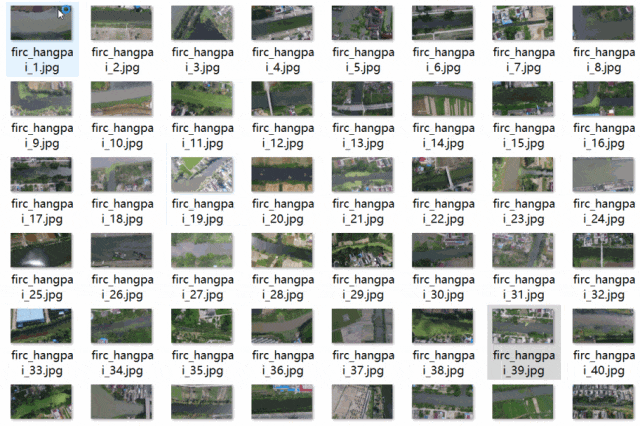
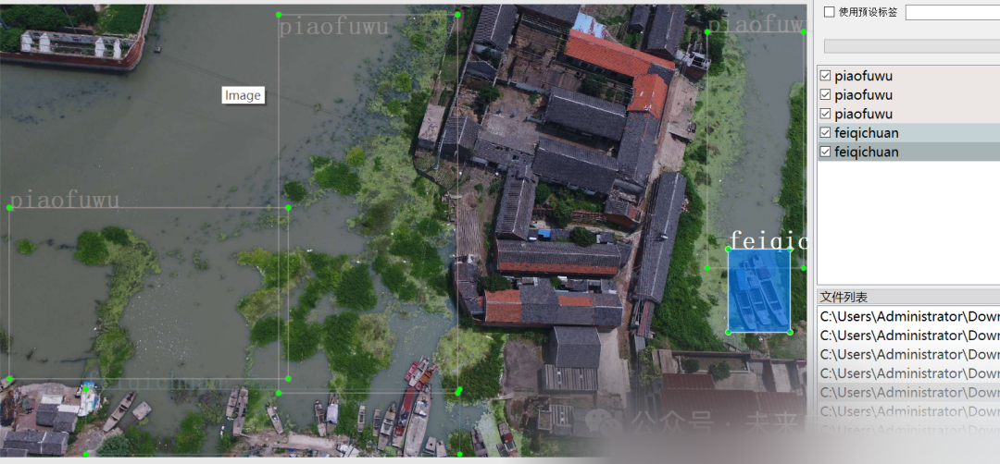

# Remotely Piloted Vehicle (RPV) Water Pollution Detection Dataset in VOC+YOLO format with 2999 images across 5 categories

Dataset format: Pascal VOC format + YOLO format (txt file without split path, only containing jpg images and corresponding VOC format xml files and YOLO format txt files)
Number of images (number of jpg files): 2999
Number of annotations (number of xml files): 2999
Number of annotations (number of txt files): 2999
Number of annotation categories: 5
Annotation category names: ["buyuyangzhi", "feiqichuan", "feiqiwu", "piaofuwu", "shuiwuran"]
Number of boxes per category annotated:

| Serial Number || Category Name || Box Count |

1. Buyuyangzhi (Fishery and Aquaculture) | 710
2. Feiqichuan (Discarded Ships) | 1215
3. Feiqiwu (Waste) | 156
4. Piaofuwu (Floating Objects) | 5495
5. Shuiwuran (Water Pollution) | 488
Total: 5 | 8064

Using labelImg:

Annotation rules: Rectangular boxes are drawn around categories.
Important note: No specifics available.
Special statement: This dataset does not guarantee the accuracy or precision of models trained on it, nor does it provide accurate and reasonable annotations.
Image preview:

Annotation example:

## Payment

Here is a pay link on Stripe ( https://buy.stripe.com/3cs8yP7sY87d0vu9AB ). Please contact me lonlonago@foxmail.com after funding $89, and I will send you a complete data files , thank you!

